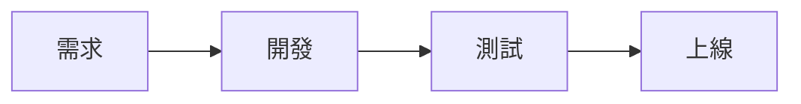

# 專案進度報告

## 一句話說明這份簡報要讓聽眾帶走什麼

報告人 · 部門 · 2026-10

???
講稿寫在 ??? 之後,只在「講稿」面板顯示,投影片上看不到。

---

## 結論先講:三件事

- **第一件事**:結果,加上一個數字
- **第二件事**:結果,加上一個數字
- **第三件事**:還在進行,預計完成時間

---

# 第一部分

### 只有標題的頁面會變成章節頁

---

## 之前與之後

### 之前
- 每次要手動做 X,約 20 分鐘
- 結果靠人檢查

|||

### 之後
- 一鍵完成,約 10 秒
- 自動告警

---

## 數字一覽

| 項目 | 目標 | 實際 |
|---|---|---|
| 上線專案 | 5 | 5 |
| 緊急修正 | 0 | 0 |
| 平均處理時間 | 10 分鐘 | 3 分鐘 |

---

## 流程

---

<!-- layout: center -->

> 用一句話收尾,重複最重要的結論。

謝謝
