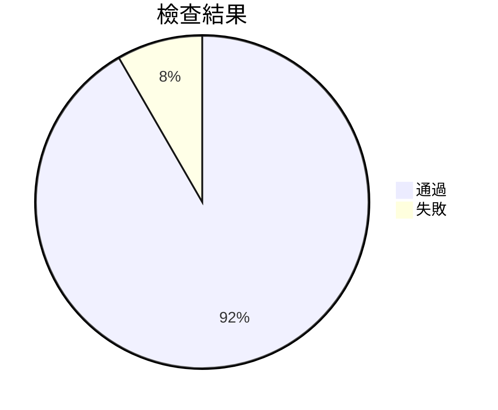

# 驗收報告

> [!NOTE]
> **結論**：一句話講結果（例如「12 項全部通過，1 項風險未涵蓋，列在最後一節」）。讀者只看這裡也要知道該怎麼做。

| 項目 | 內容 |
|---|---|
| 受測版本 | `abc1234`（分支 `release/x`） |
| 環境 | 正式站資料、唯讀操作 |
| 日期 | 2026-01-01 |

## 結果總覽

| # | 檢查 | 結果 | 備註 |
|---|---|---|---|
| 1 | 登入流程 | ✓ 通過 | |
| 2 | 匯出報表 | ✗ 失敗 | 見「問題 1」 |

## 畫面

截圖放在 `img/`，用相對路徑引用；讀者點圖會放大，手機可以雙指縮放。

## 問題 1：匯出報表逾時

> [!WARNING]
> 超過 30 秒會中斷，資料量大時必定重現。

重現步驟：

1. 開啟報表頁
2. 選擇整年範圍
3. 按「匯出」

原因與修法寫在這裡，需要引用來源時用註腳[^log]。

## 未涵蓋的風險

- 列出這次沒測到、但可能出事的地方。

[^log]: 來源：`server.log` 2026-01-01 10:32 的逾時紀錄。
